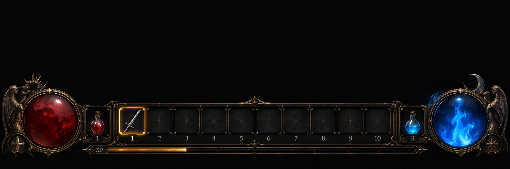
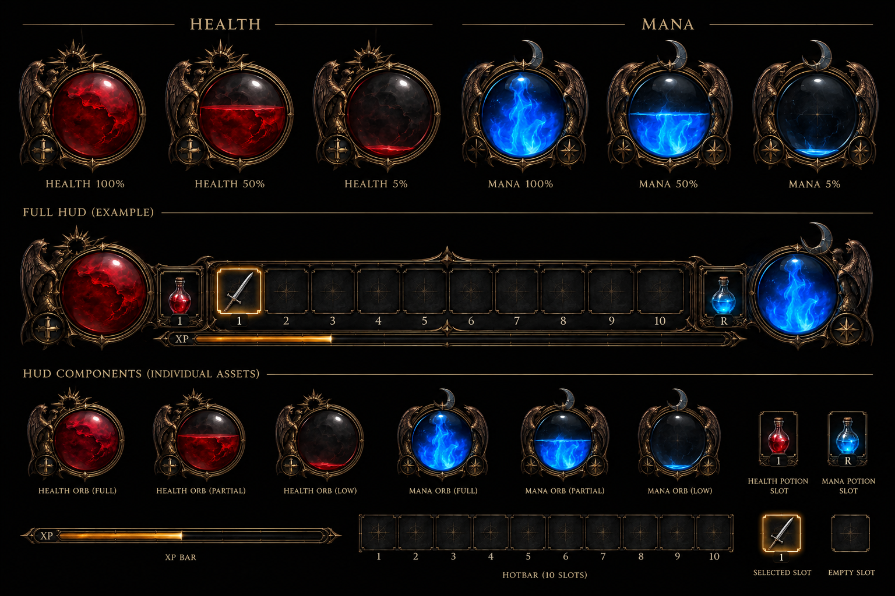

# First-person HUD — design

**Status:** design approved by the developer (2026-10-10). Replaces BG3's vanilla HUD while first person is on. The current ImGui crosshair + status line is a stand-in until this lands (M4, with the charge bars possibly earlier).

## Layout (bottom of the screen, left → right)

| Element | Notes |
| --- | --- |
| **Health orb** (left) | Red liquid orb in a winged bronze frame with a sun crest. The liquid level = current HP %. States drawn: 100 / 50 / 5 %. |
| **Health potion slot** | Small framed slot with a red flask. Key label on the art: `1`. |
| **Hotbar, 10 slots** | Keys 1–0. The selected / armed slot has a gold glow (art shows a sword in slot 1). Empty slots show a faint compass mark. |
| **Mana potion slot** | Blue flask. Key label `R`. |
| **Mana orb** (right) | Blue flame orb with a crescent-moon crest. Level = current mana %. States: 100 / 50 / 5 %. |
| **XP bar** | Thin gold bar under the hotbar. |

## Charge bars (new, not in the art yet)

- **Spell cast bar:** fills over the spell's cast time (2 s base × cast-time modifiers) while channelling. It switches to a READY state when the loop animation starts, and drains or hides on cancel (RMB / same key). Mana-blue styling; placement TBD (above the hotbar centre, or around the crosshair).
- **Bow draw bar:** a different style from the spell bar. It shows the draw %, a marker at the ~30 % minimum shot and a tick at full draw, and holds at full forever (decided). Amber/gold styling; suggested as an arc around the crosshair.

## Open questions

- **The health potion key label `1` clashes with hotbar slot 1.** Suggest `Q` for health (with `R` for mana), or decide that potions live on hotbar slots.
- What goes in a slot when a melee weapon is equipped (the sword in slot 1): weapon swap slots, or spells only?

## Implementation notes (for whoever builds it)

- **The art is a flattened composite.** Live fill levels need **layered assets**:
  - orb frame (without the orb);
  - liquid texture;
  - a fill mask or clip rectangle;
  - a glass / highlight overlay;
  - slot frame: normal / selected / empty;
  - potion icons;
  - XP bar frame + fill;
  - charge-bar frame + fill (spell and bow).
  The 100 / 50 / 5 % renders are references, not runtime frames.
- **Fill:** clip the liquid layer vertically by the % (with a slight meniscus line as in the art). Low HP / mana can pulse.
- **Engine options:** ImGui images (quick, SE IMGUI) for a first version, then Noesis (native BG3 UI via `Ext.UI`) for the final one. Hide BG3's own hotbar, portraits and action bar while POV is on, and restore them when it's off, or in dialogue and menus.
- Spell icons come from BG3's own spell icons (stats `Icon`). Cooldown and mana-too-low states can be overlays.
